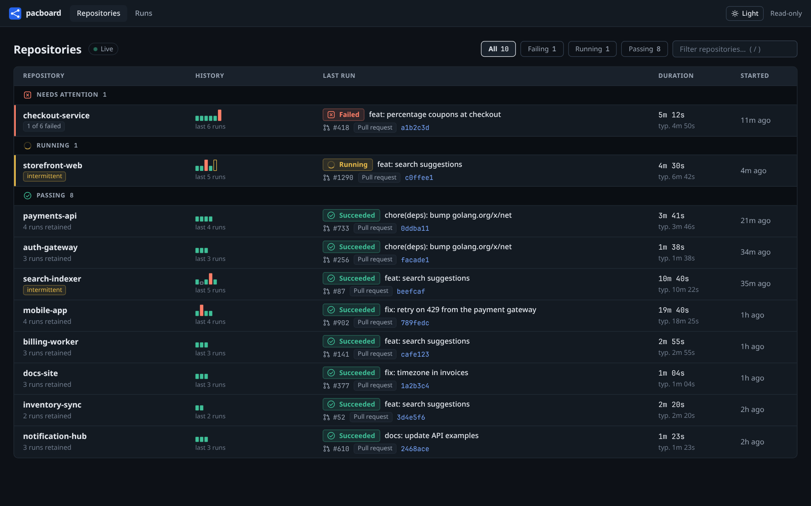
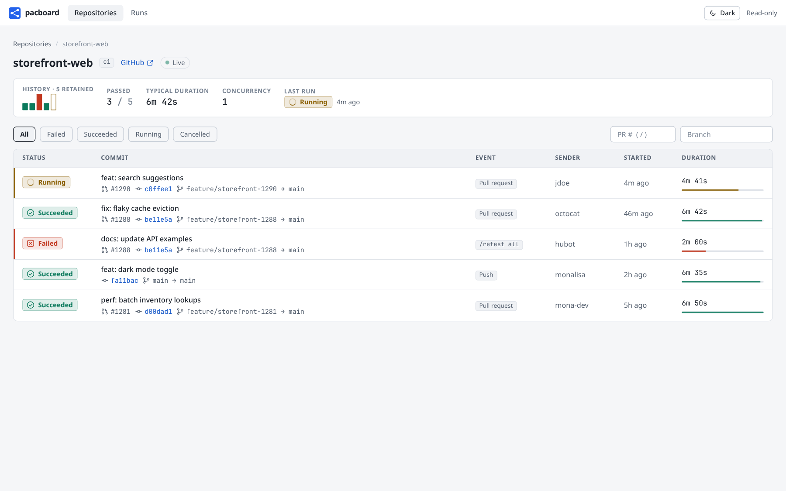

<!--
SPDX-FileCopyrightText: The pacboard Authors

SPDX-License-Identifier: AGPL-3.0-or-later
-->

# pacboard

A dashboard for [Tekton Pipelines-as-Code](https://pipelinesascode.com) (PaC) runs.

[](https://artifacthub.io/packages/search?repo=pacboard)


The Tekton Dashboard lists PipelineRuns as a flat list and knows nothing about GitHub. pacboard
adds what PaC users miss:

- **Repository health at a glance**: failing repositories first, the last runs of each as a
  strip, typical duration, and a flag for repositories whose same commit both passed and failed.
- **Why it failed, above the fold**: the failed task and step and the first `::error::` line of its
  log, with a jump to that line.
- **Per-repository view** of runs, filterable by pull request, branch and status.
- **Links back to GitHub**: repository, commit, pull request and check run.
- **A correct DAG** of each run: `runAfter`, result references, `finally` tasks, matrix fan-out,
  and tasks that were skipped.
- **Live logs** per step, streamed while the step runs, and live status updates (SSE).
- **Rerun** a run by posting `/retest <pipeline>` or `/test <pipeline>` as a PR comment, as the
  logged-in GitHub user. PaC's own ACL decides whether the comment is honoured.

pacboard is read-only towards the cluster. It is a Go binary with the Vue UI embedded; there is no
database. State comes from informer caches on `Repository`, `PipelineRun` and `TaskRun` objects.

The HTTP contract between backend and UI is [docs/api.md](docs/api.md).

| Repositories | Runs of a repository |
|---|---|
|  |  |


Screenshots use synthetic demo data.

## Quick start (local)

You need Go 1.27, [bun](https://bun.sh) and a kubeconfig whose user can read the Tekton and PaC
objects (a read-only user is enough, see [`deploy/clusterrole.yaml`](deploy/clusterrole.yaml)).

```sh
make web-build     # builds web/dist, embedded into the binary
make run-dev       # go run ./cmd/pacboard --auth-mode none --namespaces tekton-ci on 127.0.0.1:8080
```

`make run-dev KUBE_CONTEXT=my-ctx NAMESPACES=ci,other` picks another context or namespaces. For UI
work run `make web-dev` as well; Vite proxies `/api` and `/auth` to port 8080.

`--auth-mode none` has no login: anyone who can reach the port can read everything, and reruns are
disabled. To try reruns locally, export a GitHub token and pass `--dev-github-token-env GITHUB_TOKEN`;
every visitor then comments as that user, so use it on localhost only. pacboard logs a warning when
it is active.

## Configuration

Every flag can also be set with an environment variable `PACBOARD_<FLAG>` (upper case, `-` becomes
`_`); the command line wins. Prefer the environment for secrets.

| Flag | Default | Meaning |
|---|---|---|
| `--listen` | `:8080` | listen address |
| `--kubeconfig`, `--kube-context` | | use a kubeconfig; without them (and without `KUBECONFIG`) the in-cluster service account is used |
| `--namespaces` | all | comma-separated namespaces to watch |
| `--auth-mode` | `github` | `github` or `none` |
| `--github-client-id`, `--github-client-secret` | | OAuth App credentials |
| `--github-url` | `https://github.com` | GitHub web URL; set for GitHub Enterprise |
| `--allowed-orgs` | | organizations whose members may use pacboard (required in `github` mode) |
| `--session-key` | | secret of at least 32 bytes that encrypts session cookies (required in `github` mode) |
| `--public-url` | | external base URL; the OAuth callback is `<public-url>/auth/callback` (required in `github` mode) |
| `--dev-github-token-env` | | development only, see above |
| `--log-level` | `info` | `debug`, `info`, `warn`, `error` |

### GitHub login

1. Create an OAuth App (GitHub → Settings → Developer settings → OAuth Apps), or a GitHub App.
2. Set the authorization callback URL to `<public-url>/auth/callback`.
3. pacboard requests the scopes `read:org repo`: `read:org` to verify organization membership and
   `repo` to post the PR comment as the user. A GitHub App's user authorization needs no scopes.
4. Give pacboard the client ID and secret, `--allowed-orgs`, `--public-url`, and a random session key
   (`openssl rand -base64 48`). For organizations with OAuth App access restrictions, an owner has to
   approve the app.

## Deploy to Kubernetes

With Helm (chart published to ghcr.io on every release, listed on Artifact Hub):

```sh
helm install pacboard oci://ghcr.io/m0rf30/charts/pacboard \
  --namespace pacboard --create-namespace --set 'namespaces={tekton-ci}'
```

Release images and charts are signed keyless with [cosign](https://github.com/sigstore/cosign)
from this repository's CI:

```sh
cosign verify ghcr.io/m0rf30/pacboard:<version> \
  --certificate-identity-regexp '^https://github.com/M0Rf30/pacboard/\.github/workflows/ci\.yml@refs/tags/v' \
  --certificate-oidc-issuer https://token.actions.githubusercontent.com
cosign verify ghcr.io/m0rf30/charts/pacboard:<chart-version> \
  --certificate-identity-regexp '^https://github.com/M0Rf30/pacboard/\.github/workflows/ci\.yml@refs/tags/v' \
  --certificate-oidc-issuer https://token.actions.githubusercontent.com
```

The chart defaults to `auth.mode: none`; see [`charts/pacboard/README.md`](charts/pacboard/README.md)
for GitHub login and the Pipelines-as-Code `custom-console-*` settings that link check runs here.

Or with plain kustomize:

```sh
kubectl create namespace pacboard
kubectl -n pacboard create secret generic pacboard \
  --from-literal=github-client-id=... \
  --from-literal=github-client-secret=... \
  --from-literal=session-key="$(openssl rand -base64 48)"
# edit the configMapGenerator in deploy/kustomization.yaml (namespaces, public URL, allowed orgs)
kubectl apply -k deploy
```

[`deploy/`](deploy) holds the Deployment, Service, ServiceAccount, and a ClusterRole that grants only
`get`, `list`, `watch` on `repositories.pipelinesascode.tekton.dev` and on `pipelineruns`,
`taskruns` and `pipelines` in `tekton.dev`, plus `get` on `pods/log`. Put an Ingress or Gateway with
TLS in front of the Service and use its URL as `--public-url`; session cookies are marked `Secure`
when it is `https`.

The image is built with `make docker-build` (`docker/Dockerfile`: bun and Go build stages, a
distroless non-root runtime). The base images are pinned by digest; Dependabot's `docker`
ecosystem bumps tag and digest together, and `.dockerignore` keeps `.git`, `web/node_modules` and
`web/dist` out of the build context.

## Security model

- **Authentication**: in `github` mode every `/api/v1/*` route except `/api/v1/me` needs a session
  and membership of an allowed organization (checked at login, re-checked every 10 minutes while the
  session lives). Anonymous requests get 401, non-members 403.
- **Sessions** are AES-256-GCM encrypted cookies (`HttpOnly`, `SameSite=Lax`) holding login, avatar
  and the user's GitHub token. They are stateless: restarting with another `--session-key` logs
  everybody out. A session is valid until it expires (24 hours); logout only clears the
  `pacboard_session` and `pacboard_csrf` cookies in the browser and the server-side membership
  cache entry, it cannot revoke a cookie that was copied. To end a session for good, revoke the
  user's authorization of the OAuth app on GitHub (the next membership re-check fails) or rotate
  `--session-key`.
- **Streams** (log and event streams) have a 30 second deadline per write, so a client that stops
  reading is dropped instead of holding a goroutine and a pod-log stream open. The event stream also
  ends when its session expires, and in `github` mode each heartbeat (20 seconds) re-checks the
  session and the (cached) organization membership, so a removed member or revoked token loses the
  stream at the next re-check.
- **CSRF**: unsafe requests need the header `X-Pacboard-CSRF` equal to the `pacboard_csrf` cookie.
- **Reruns** post exactly `/retest <name>` or `/test <name>`, where the name is validated, as the
  user, with the user's token. pacboard has no service credentials to GitHub.
- **Untrusted data**: run annotations can be influenced by a pull request's `.tekton` files. Every
  URL pacboard emits is an absolute `http(s)` URL or empty, and the UI renders all text escaped.
- **Headers**: a strict `Content-Security-Policy`, `X-Frame-Options: DENY`, `nosniff`, `no-store`
  on API responses.
- **Cluster access** is read-only; pod logs are served only for TaskRuns of a known PipelineRun.
- A failed run's detail reads the last 2 MiB of the failed step's log once (cached per run version)
  to show the `::error::` message; concurrent requests share that read, and if the pod is gone (or
  the log is briefly unreadable) it falls back to the run's condition message.
- Run logs can contain secrets that a build prints. Every allowed organization member can read them.

## Development

```sh
make check   # fmt, vet, lint
make test    # go test -race ./...
cd web && bun run typecheck && bun run test
```

See [AGENTS.md](AGENTS.md) for the code layout and conventions.

## License

AGPL-3.0-or-later. The repository follows the [REUSE](https://reuse.software) specification.
